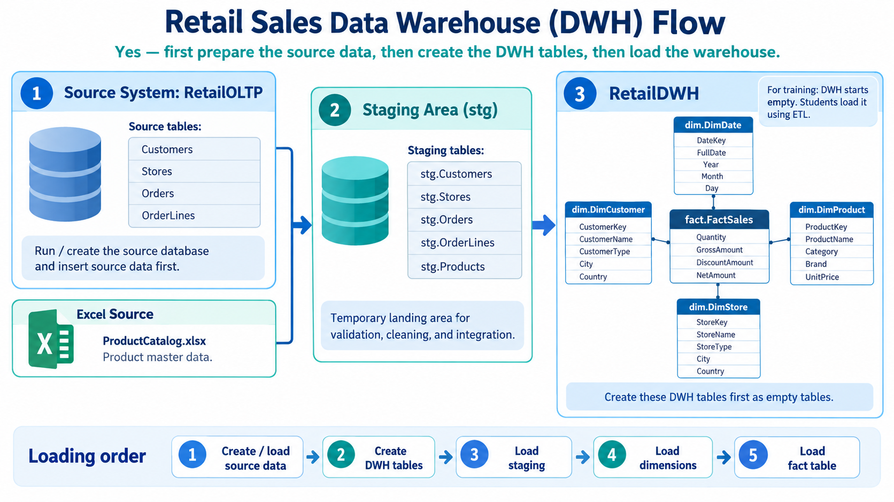
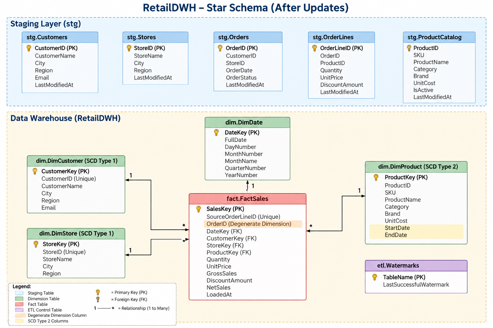

# Retail Sales Data Warehouse (DWH) Project

A robust, end-to-end Data Warehouse solution designed to analyze retail sales performance. This project integrates multiple heterogeneous data sources (OLTP relational database and external Excel catalog), transforms raw data across a structured **Medallion Architecture (Bronze / Silver / Gold)**, and models the business layer into an optimized **Star Schema** with **SCD Type 2** historical tracking.

---

## 🏗️ Architecture Overview

The pipeline follows a multi-tier Medallion architecture combined with modern data warehousing practices:

```
+--------------------+        +-------------------------+        +--------------------------+
|    BRONZE LAYER    |  --->  |      SILVER LAYER       |  --->  |        GOLD LAYER        |
|  (Source & Raw)    |        | (Staging & Cleansing)   |        |  (Star Schema / Mart)    |
+--------------------+        +-------------------------+        +--------------------------+
| - RetailOLTP DB    |        | - Data Validation       |        | - dim.DimCustomer (SCD 1)|
| - ProductCatalog   |        | - Type Casting          |        | - dim.DimStore (SCD 1)   |
|   (Excel/CSV)      |        | - Deduplication         |        | - dim.DimProduct (SCD 2) |
| - Landing Tables   |        | - Schema Normalization  |        | - dim.DimDate            |
|                    |        |                         |        | - fact.FactSales         |
+--------------------+        +-------------------------+        +--------------------------+
```

---

## 🛠️ Data Layers (Medallion Approach)

<p align="center">
  
</p>

### 1. 🥉 Bronze Layer (Raw Ingestion)
* **Sources:**
  * **Transactional Database (`RetailOLTP`)**: `Customers`, `Stores`, `Orders`, and `OrderLines`.
  * **File Ingestion (`ProductCatalog.xlsx` / CSV)**: Product master data containing category, brand, SKU, and unit costs.
* **Characteristics:** Captures data in its rawest state without modifying business values.

### 2. 🥈 Silver Layer (Staging & Transformation)
* **Schema / Tables:** `stg.*` (or intermediate preparation layer).
* **Transformations & Cleansing:**
  * Extracted and converted high-precision timestamps (e.g., nanosecond precision converted to `DATETIME2`).
  * Enforced column constraints and handled nullable fields.
  * Cleansed string types, removed trailing whitespace, and verified primary/business keys.
  * Prepared datasets for dimensional matching and metric calculations.

### 3. 🥇 Gold Layer (Star Schema / Presentation)
* Modelled specifically for high-performance analytical queries and business intelligence (BI) reporting.
* Implements a **Star Schema** centered around business transactions.

---

## ⭐ Dimensional Modeling (Star Schema)

<p align="center">
  
</p>

<p align="center">
  
</p>

### **Dimension Tables**
* **`dim.DimDate`**: Date dimension supporting smart integer keys (`YYYYMMDD`) for partition-friendly time-series analysis.
* **`dim.DimCustomer` (SCD Type 1)**:
  * Surrogate Key: `CustomerKey` (Identity).
  * Business Key: `CustomerID` (Unique).
  * Captures latest customer attributes (`CustomerName`, `City`, `Region`, `Email`).
* **`dim.DimStore` (SCD Type 1)**:
  * Surrogate Key: `StoreKey` (Identity).
  * Business Key: `StoreID` (Unique).
  * Captures store details (`StoreName`, `City`, `Region`).
* **`dim.DimProduct` (SCD Type 2)**:
  * Captures historical changes to product attributes and pricing.
  * Tracks temporal validity using `StartDate` and `EndDate`.
  * Handles versioning via `ProductKey` while preserving `ProductID`.

### **Fact Table**
* **`fact.FactSales`**:
  * **Primary Key:** `SalesKey` (Surrogate Identity).
  * **Degenerate Dimension:** `OrderID` preserved directly in the fact table for transaction tracing without a separate dimension table.
  * **Foreign Keys:** `DateKey`, `CustomerKey`, `StoreKey`, `ProductKey`.
  * **Metrics / Measures:**
    * `Quantity`
    * `UnitPrice`
    * `GrossSales` ($\text{Quantity} \times \text{UnitPrice}$)
    * `DiscountAmount`
    * `NetSales` ($\text{GrossSales} - \text{DiscountAmount}$)
    * `LoadedAt` (audit timestamp)

---

## 🔄 ETL & Data Transformation Pipeline

1. **Source Data Preparation:**
   * Scripted OLTP seed schemas and imported catalog spreadsheets via flat file pipelines.
2. **Dimension Loading:**
   * Dimensions are loaded prior to the Fact table.
   * Auto-generated Surrogate Keys (`IDENTITY(1,1)`).
   * SCD Type 2 logic assigns temporal stamps to products (`StartDate` initialized, `EndDate` set to `NULL` for current records).
3. **Fact Loading & Key Lookup:**
   * Combined transactional header (`Orders`) and line items (`OrderLines`).
   * Performed lookups against dimension tables to map business keys to warehouse surrogate keys.
   * SCD Type 2 temporal joins applied on products (`OrderDate BETWEEN StartDate AND EndDate` or active record).
   * Computed calculated financial metrics on the fly.

---

## 🚀 Getting Started

### Prerequisites
* Microsoft SQL Server (2019 or later recommended).
* SQL Server Management Studio (SSMS) or Azure Data Studio.

### Deployment Order
1. Run DDL scripts to create database schemas: `stg`, `dim`, and `fact`.
2. Populate the source tables / staging layer with raw transactional and catalog data.
3. Execute dimension loading scripts (`dim.DimCustomer`, `dim.DimStore`, `dim.DimProduct`, `dim.DimDate`).
4. Execute the fact population script to load `fact.FactSales`.
5. Run integrity checks to verify foreign key relationships and measure aggregations.
